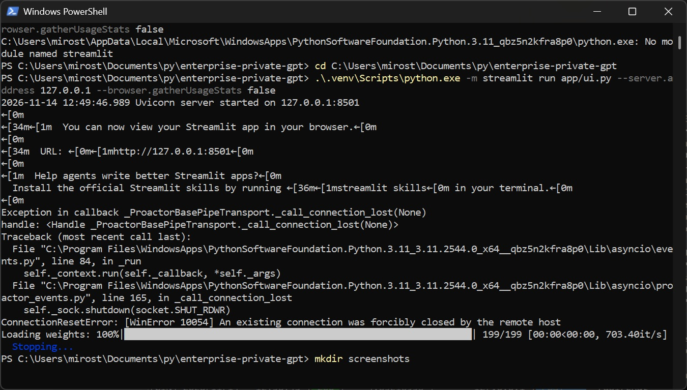

# Enterprise Private GPT

### Локальный корпоративный RAG-ассистент на базе Qwen3 8B, ChromaDB и Streamlit

## 1. Описание проекта

Enterprise Private GPT — прототип корпоративного чат-бота, предназначенного для поиска информации во внутренних документах организации с использованием локальной языковой модели и технологии Retrieval-Augmented Generation (RAG).

Главная цель проекта — реализовать систему, в которой обработка документов, семантический поиск и генерация ответов выполняются на локальном компьютере без необходимости передачи корпоративной информации во внешние облачные LLM API.

**Основные возможности:**

- Загрузка и обработка корпоративных документов PDF, TXT и MD.
- Разбиение документов на смысловые фрагменты (chunking).
- Генерация мультиязычных текстовых эмбеддингов.
- Хранение документов и векторов в локальной ChromaDB.
- Семантический поиск релевантных фрагментов (Top-K).
- Генерация ответов с помощью локальной Qwen3 8B.
- Отображение использованных источников и страниц документов.
- Измерение времени retrieval и генерации.
- Пользовательский веб-интерфейс на Streamlit.

## 2. Технологический стек

| Компонент | Технология |
|---|---|
| Язык программирования | Python 3.11 |
| LLM | Qwen3 8B, 4-bit quantization |
| LLM Runtime | Ollama |
| Embedding Model | intfloat/multilingual-e5-base |
| Vector Database | ChromaDB |
| Chunking | LangChain RecursiveCharacterTextSplitter |
| PDF Processing | PyMuPDF |
| User Interface | Streamlit |
| Hardware | NVIDIA GeForce RTX 4070 Laptop GPU, 8 GB VRAM |

### Обоснование выбора моделей

**Qwen3 8B**

В качестве основной языковой модели выбрана Qwen3 8B, поскольку она поддерживает русский язык, подходит для решения задач обработки текста и может быть запущена локально с использованием квантования.

Применение 4-битной квантованной версии позволяет существенно сократить требования к видеопамяти по сравнению с моделями в FP16/BF16.

Для RAG установлен низкий параметр temperature (0.1), что позволяет уменьшить вариативность ответов. Режим рассуждений отключён (`think=False`) для сокращения расходов вычислительных ресурсов.

**Multilingual E5 Base**

Для генерации эмбеддингов используется `intfloat/multilingual-e5-base`.

Причины выбора:

- Поддержка нескольких языков, включая русский.
- Обучение для задач семантического сопоставления текстов.
- Размерность эмбеддингов — 768.
- Возможность локального запуска без обращения к внешним API.

Модель использует префиксы `passage:` для документов и `query:` для пользовательских запросов.

В целях экономии видеопамяти генерация эмбеддингов выполняется на CPU, а GPU преимущественно используется для генерации ответов LLM.

## 3. Архитектура системы

Система состоит из двух основных пайплайнов.

**Индексация документов:**

```text
PDF / TXT / MD
     |
     v
Text Extraction (PyMuPDF)
     |
     v
Text Cleaning
     |
     v
Chunking (900 chars, overlap 150)
     |
     v
Multilingual E5 Base
     |
     v
ChromaDB (local storage)
```

**Обработка пользовательского запроса:**

```text
User Question
     |
     v
Query Embedding
     |
     v
ChromaDB Similarity Search
     |
     v
Top-K Retrieved Chunks
     |
     v
Context + System Prompt
     |
     v
Qwen3 8B (Ollama)
     |
     v
Grounded Answer + Sources
     |
     v
Streamlit UI
```

Векторная база сохраняет текст фрагментов и метаданные, включающие название документа, номер страницы и идентификатор фрагмента.

Системный промпт предписывает языковой модели использовать только предоставленный контекст и отказываться от ответа при недостатке информации.

## 4. Тестовые данные

Для тестирования использован документ:

**«Памятка для муниципальных служащих по правилам делового этикета»**, администрация города Тамбова, 2022 год.

Документ содержит правила делового общения, требования к внешнему виду, нормы поведения и инструкции по телефонным переговорам.

Документ позволяет проверить способность RAG-системы извлекать конкретные факты, интерпретировать правила и отличать информацию из базы знаний от внешних знаний модели.

## 5. Результаты тестирования

### Тест №1. Вопрос по базе знаний

**Вопрос:**

«В какое время разрешены деловые звонки?»

**Ожидаемый ответ:**

«С 9:00 до 21:00».

При тестировании retrieval-компонента релевантный фрагмент обнаружен на первой позиции.

**Фактические показатели retrieval:**

| Метрика | Результат |
|---|---|
| Найденный документ | Pamjatka_Delovoe_obshchenie.pdf |
| Страница | 5 |
| Позиция | Top-1 |
| Cosine distance | 0.1331 |
| Cosine similarity | 0.8669 |
| Hit@1 | 1.0 |
| Reciprocal Rank | 1.0 |

Таким образом, система успешно извлекла фрагмент, содержащий точный ответ на пользовательский вопрос.

**Ответ Qwen3 8B:** [Вставить фактически полученный ответ]

**Скриншот интерфейса:**


### Тест №2. Вопрос вне базы знаний

**Вопрос:**

«Как приготовить яблочный пирог?»

**Ожидаемое поведение:**

Система должна отказаться от генерации ответа, поскольку корпоративный документ не содержит информации о приготовлении пищи.

Ожидаемый текст отказа:

> В предоставленных документах нет информации для ответа на этот вопрос.

**Фактический ответ:** [Вставить ответ модели]

**Результат:** [Успешный отказ / Некорректный ответ]

**Скриншот:**


Данный тест позволяет оценить способность RAG-системы ограничивать генерацию рамками корпоративных документов.

### Тест №3. Сложный вопрос и конфликт фактов

**Вопрос:**

«Какое время считается наилучшим для телефонных переговоров согласно памятке?»

**Ожидаемый ответ:**

«С 8:00 до 9:30, с 13:30 до 14:00 и после 16:30».

Особенность тестового документа заключается в том, что в нём отдельно указаны разрешённое время деловых звонков (9:00–21:00) и наилучшие интервалы для телефонных переговоров.

Задача модели — не смешивать эти два положения и использовать точную информацию из документа.

**Фактический ответ:** [Вставить ответ модели]

**Результат:** [Корректный / Некорректный]

**Скриншот:**


Данный тест проверяет способность модели корректно интерпретировать разные положения одного документа. Он не является полноценным экспериментом по конфликту документа с параметрическими знаниями LLM, но позволяет выявлять ошибки интерпретации контекста.

## 6. Исследование Top-K и Latency

В системе предусмотрено изменение параметра Top-K — количества фрагментов, возвращаемых векторной базой.

Для эксперимента выбраны значения K = 2, 4, 6 и 8.

| Top-K | Page Hit@K | Page MRR | Mean Latency |
|---|---|---|---|
| 2 | [значение] | [значение] | [значение] |
| 4 | [значение] | [значение] | [значение] |
| 6 | [значение] | [значение] | [значение] |
| 8 | [значение] | [значение] | [значение] |

При увеличении Top-K возрастает количество контекста, передаваемого LLM. Это потенциально повышает вероятность нахождения необходимой информации, однако может увеличить задержку генерации и количество нерелевантных фрагментов.

Оптимальное значение Top-K следует выбирать на основе экспериментальной оценки, а не только по количеству извлекаемых документов.

## 7. Особенности локального развёртывания

### Ограничения вычислительных ресурсов

Проект разрабатывался на ноутбуке с NVIDIA RTX 4070 Laptop GPU и 8 ГБ VRAM.

Использование квантованной Qwen3 8B позволило выбрать модель, совместимую с ограниченным объёмом видеопамяти. При этом для KV-cache, контекста и служебных буферов требуется дополнительная память.

Для уменьшения нагрузки использовались следующие настройки:

- Квантованная LLM.
- Контекстное окно 4096 токенов.
- Ограничение длины генерации 400 токенами.
- Отключённый thinking-режим.
- CPU inference для embedding-модели.

При недостатке видеопамяти часть вычислений может переноситься в оперативную память, что увеличивает время генерации. Фактическое размещение модели необходимо контролировать через `ollama ps` и `nvidia-smi`.

### Скорость ответа

В отличие от облачных API, локальная генерация ограничивается производительностью пользовательского оборудования.

Время ответа зависит от длины вопроса, размера извлечённого контекста, количества генерируемых токенов и загрузки GPU.

В приложении отдельно измеряются:

- Retrieval latency.
- Generation latency.
- Total latency.

### Галлюцинации и ошибки

Основным ограничением локальной RAG-системы остаётся возможность генерации ответов, которые не подтверждаются корпоративными документами.

Даже при использовании строгого системного промпта модель потенциально может:

- Использовать собственные знания вместо извлечённого контекста.
- Ответить на вопрос при отсутствии релевантной информации.
- Некорректно интерпретировать положения документа.
- Указать источник, который не подтверждает ответ.

Для снижения этих рисков реализованы ограничения системного промпта, использование извлечённого контекста и возможность фильтрации фрагментов по cosine distance.

При этом надёжность данных механизмов требует отдельной экспериментальной проверки.

## 8. Безопасность корпоративных данных

Основным преимуществом архитектуры является возможность полностью локальной обработки документов.

В проекте используются:

- Локальная LLM через Ollama.
- Локальная модель эмбеддингов.
- Локальная векторная БД ChromaDB.
- Локальный пользовательский интерфейс Streamlit.

При корректной конфигурации система не нуждается во внешних LLM API для выполнения запросов.

Это снижает риск раскрытия документов сторонним поставщикам облачных сервисов.

Однако локальное развёртывание само по себе не обеспечивает абсолютной безопасности.

**Основные потенциальные угрозы:**

1. Несанкционированный доступ к файлам и векторной базе.
2. Prompt injection через содержимое документов.
3. Утечки через журналы, сетевые соединения и сторонние зависимости.
4. Отсутствие ролевой модели доступа к корпоративной информации.
5. Генерация недостоверных или неподтверждённых ответов.

Для промышленного использования потребуется дополнительная защита: аутентификация и авторизация, ACL на уровне документов, контроль сетевого доступа, шифрование данных, аудит и тестирование устойчивости к prompt injection.

**Вывод о безопасности:** локальная RAG-архитектура уменьшает зависимость от облачных сервисов и позволяет обрабатывать корпоративные документы внутри контролируемого контура. Однако для признания системы защищённым корпоративным решением необходимы дополнительные организационные и технические меры.

## 9. Установка и запуск

### Требования

- Windows 10/11.
- Python 3.11.
- Ollama.
- NVIDIA GPU (рекомендуется для Qwen3 8B).
- Достаточный объём RAM для локальных моделей.

### Установка

```powershell
git clone https://github.com/YOUR_USERNAME/enterprise-private-gpt.git
cd enterprise-private-gpt

python -m venv .venv

.\.venv\Scripts\python.exe -m pip install -r requirements.txt

ollama pull qwen3:8b
```

Загрузка embedding-модели:

```powershell
.\.venv\Scripts\python.exe -c "from sentence_transformers import SentenceTransformer; m = SentenceTransformer('intfloat/multilingual-e5-base', device='cpu'); m.save('models/multilingual-e5-base')"
```

Поместите разрешённые к обработке документы в `data/documents/`.

Создайте индекс:

```powershell
.\.venv\Scripts\python.exe -m app.ingestion
```

Запустите приложение:

```powershell
.\.venv\Scripts\python.exe -m streamlit run app/ui.py --server.address 127.0.0.1 --browser.gatherUsageStats false
```

Адрес интерфейса:

`http://127.0.0.1:8501`

Для полноценного автономного запуска предварительно необходимо загрузить зависимости и модели, а также проверить отсутствие внешних сетевых соединений.

## 10. Итоговые выводы

В рамках проекта разработан прототип локального корпоративного RAG-ассистента, объединяющего Qwen3 8B, multilingual-e5-base, ChromaDB и Streamlit.

Реализованы основные компоненты: обработка документов, чанкинг, создание эмбеддингов, семантический поиск и генерация ответов на основе извлечённого контекста.

Первоначальная проверка retrieval показала успешное нахождение релевантного фрагмента корпоративного документа на первой позиции с cosine distance 0.1331.

Локальная архитектура позволяет отказаться от облачного LLM API при обработке запросов, однако предъявляет более высокие требования к вычислительным ресурсам и самостоятельному обеспечению информационной безопасности.

**Главный вывод:** локальный RAG является перспективной основой для корпоративной системы работы с внутренними знаниями, но её надёжность определяется не только качеством LLM, а также механизмами retrieval, контроля доступа, защиты данных и проверки достоверности ответов.

### Тесты. Вопросы по корпоративной базе, вне базы знаний и сложный вопрос


### Терминал с ollama


### Терминал с streamlit


