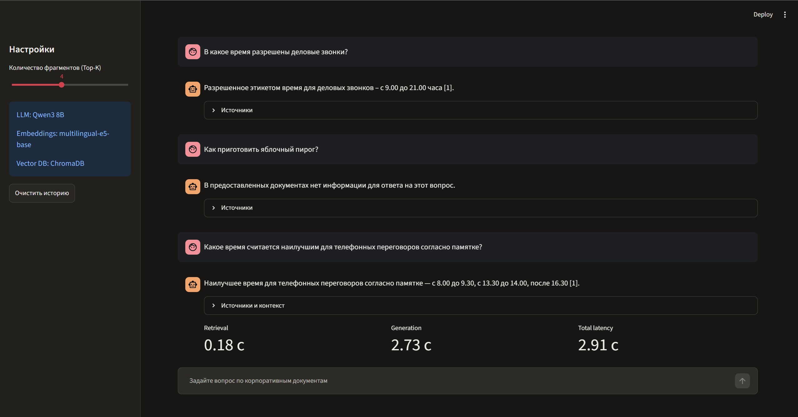
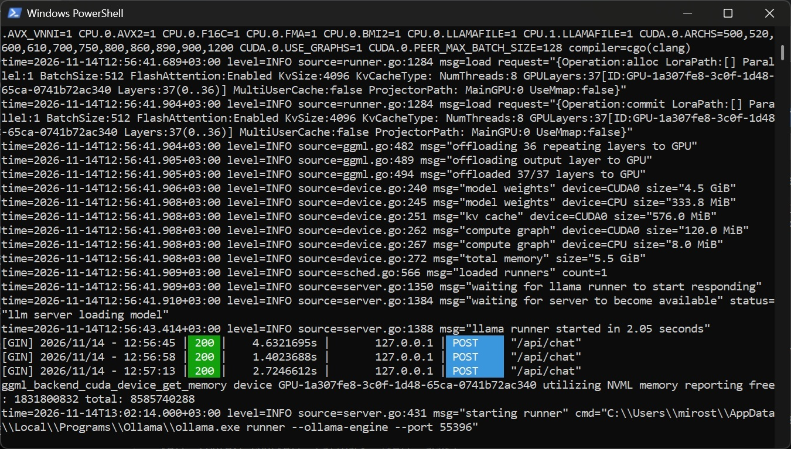

# Enterprise Private GPT

**Локальный корпоративный RAG-ассистент на базе Qwen3 8B, multilingual-e5-base и ChromaDB**

Проект выполнен в рамках домашнего задания **Enterprise Private GPT**. Цель — разработать прототип ассистента, который отвечает на вопросы по корпоративным документам без передачи запросов и содержимого базы знаний во внешние LLM API.

## Возможности

- Обработка PDF, TXT и Markdown-документов.
- Разбиение текста на фрагменты с перекрытием.
- Создание мультиязычных эмбеддингов и локальное хранение векторов.
- Семантический поиск Top-K по ChromaDB.
- Генерация ответов локальной Qwen3 8B через Ollama с указанием источников.
- Отображение ответов и метрик времени в Streamlit.
- Настройка Top-K через пользовательский интерфейс.

## 1. Технологический стек и выбор моделей

| Компонент | Реализация | Причина выбора |
| --- | --- | --- |
| LLM | Qwen3 8B, Ollama | Мультиязычная модель, доступная для локального запуска в квантованном формате |
| Embeddings | `intfloat/multilingual-e5-base` | Семантический поиск на русском языке, 768-мерные векторы |
| Vector DB | ChromaDB | Локальное персистентное хранение фрагментов и метаданных |
| Chunking | LangChain `RecursiveCharacterTextSplitter` | Простое разбиение с перекрытием |
| PDF parsing | PyMuPDF | Извлечение текста с сохранением номера страницы |
| Интерфейс | Streamlit | Чат и отображение источников и latency |
| Язык | Python 3.11 | Основной язык проекта |

**Оборудование:** NVIDIA GeForce RTX 4070 Laptop GPU с 8 ГБ VRAM.

Использование квантованной Qwen3 8B позволяет уменьшить требования к видеопамяти. Модель эмбеддингов запускается на CPU, чтобы оставить VRAM для LLM. Для E5 используется префикс `passage:` при индексации и `query:` при обработке вопросов.

## 2. Архитектура

### Индексация документов

```text
PDF / TXT / MD
       |
       v
Извлечение текста (PyMuPDF)
       |
       v
Очистка текста
       |
       v
Chunking (900 символов, overlap 150)
       |
       v
multilingual-e5-base
       |
       v
ChromaDB (локальная БД)
```

### Генерация ответа

```text
Вопрос пользователя
       |
       v
Embedding запроса
       |
       v
Similarity Search в ChromaDB
       |
       v
Top-K фрагментов + метаданные
       |
       v
System Prompt + найденный контекст
       |
       v
Qwen3 8B через локальный Ollama API
       |
       v
Ответ + источники + latency
       |
       v
Streamlit UI
```

В базе хранятся фрагменты текста, названия документов, номера страниц и идентификаторы чанков. В системном промпте указано, что при отсутствии достаточной информации модель должна отказаться от ответа. Такой промпт **не является гарантией** отсутствия галлюцинаций или prompt injection.

## 3. Тестовый документ

Для тестирования использована «Памятка для муниципальных служащих по правилам делового этикета» администрации города Тамбова (2022). В документе изложены правила делового поведения и телефонных переговоров.

## 4. Проверки и результаты

### Тест 1 — вопрос строго по базе знаний

**Вопрос:** «В какое время разрешены деловые звонки?»

**Ответ, подтверждённый документом:** с 9:00 до 21:00 (стр. 5).

**Подтверждённый результат retrieval:** нужный фрагмент найден на первой позиции; cosine distance = **0.1331** (cosine similarity = **0.8669**). Для данного вопроса Hit@1 = 1, reciprocal rank = 1.

### Тест 2 — вопрос вне базы знаний

**Вопрос:** «Как приготовить яблочный пирог?»

**Ожидаемое поведение:** отказ, поскольку рецепт не содержится в корпоративном документе. В демонстрации интерфейса показан отказ от ответа на вопрос вне базы.

### Тест 3 — сложный вопрос с близкими, но различными фактами

**Вопрос:** «Какое время считается наилучшим для телефонных переговоров согласно памятке?»

**Ответ, подтверждённый документом:** с 8:00 до 9:30, с 13:30 до 14:00 и после 16:30 (стр. 5).

Это отличается от *разрешённого времени звонков* (9:00–21:00). Тест проверяет, различает ли модель два близких положения одного документа. Он не доказывает способность разрешать любой конфликт между базой знаний и параметрическими знаниями LLM.

### Скриншоты работы

**Три типа запросов в интерфейсе:**



**Локальная модель через Ollama:**



**Запуск Streamlit:**


## 5. Анализ Top-K и производительности

Интерфейс позволяет менять количество извлекаемых фрагментов (Top-K). **Полноценное количественное сравнение K = 2, 4, 6 и 8 не проводилось**, поэтому сводные показатели качества и latency для этих конфигураций не приводятся.

При увеличении Top-K в контекст может попадать больше полезной информации, но также больше нерелевантных фрагментов. Это может увеличивать время обработки запроса и усложнять генерацию точного ответа. Выбор оптимального K требует отдельной оценки на размеченном наборе вопросов.

### Ограничения локального запуска

- **VRAM:** модель работает в условиях ограничения 8 ГБ видеопамяти; размер контекстного окна и KV-cache влияют на доступную память.
- **Скорость:** локальная генерация зависит от производительности ноутбука; облачные API могут располагать более мощными GPU, но требуют сетевого обмена.
- **Галлюцинации:** даже при наличии найденного контекста LLM может неправильно интерпретировать факты, отвечать вне базы или неверно ссылаться на источники.
- **Качество retrieval:** высокое косинусное сходство само по себе не доказывает наличие ответа в найденном чанке.

В прототипе используется низкая температура (`0.1`), контекстное окно 4096 токенов, ограничение генерации и отключённый thinking-режим. Фактические характеристики зависят от конфигурации Ollama и загрузки оборудования.

## 6. Безопасность и надёжность

Локальная архитектура позволяет выполнять обработку документов, embeddings, поиск и генерацию без внешних LLM API. Это **снижает риск передачи корпоративных данных облачным поставщикам**, но не гарантирует полную защищённость.

Для промышленного внедрения дополнительно нужны:

1. Контроль сетевых соединений и отключение нежелательной телеметрии.
2. Аутентификация пользователей и разграничение доступа к документам.
3. Защита хранилища и резервных копий, управление доступом к файлам.
4. Проверка на prompt injection в документах и пользовательских запросах.
5. Аудит, мониторинг, безопасная обработка логов и проверка обоснованности ответов.

**Вывод:** система является работоспособным локальным учебным RAG-прототипом, но называть её полностью защищённой корпоративной платформой без перечисленных мер и испытаний нельзя.

## 7. Установка и запуск

### Требования

- Windows 10/11, Python 3.11.
- Установленная [Ollama](https://ollama.com/).
- Достаточно оперативной памяти; для Qwen3 8B рекомендуется GPU.

```powershell
git clone https://github.com/mirostish/enterprise-private-gpt.git
cd enterprise-private-gpt
python -m venv .venv
.\.venv\Scripts\python.exe -m pip install -r requirements.txt
ollama pull qwen3:8b
```

**Загрузка embedding-модели** (при первом запуске требуется интернет):

```powershell
.\.venv\Scripts\python.exe -c "from sentence_transformers import SentenceTransformer; m = SentenceTransformer('intfloat/multilingual-e5-base', device='cpu'); m.save('models/multilingual-e5-base')"
```

Поместите документы, которые разрешено обрабатывать, в папку `data/documents/`. Создайте папку, если её ещё нет.

**Индексация:**

```powershell
.\.venv\Scripts\python.exe -m app.ingestion
```

**Запуск интерфейса:**

```powershell
.\.venv\Scripts\python.exe -m streamlit run app/ui.py --server.address 127.0.0.1 --browser.gatherUsageStats false
```

Интерфейс будет доступен по адресу <http://127.0.0.1:8501> при работающем локальном сервере Streamlit. Ollama также должна быть запущена. Если индекс уже создан и документы не изменились, повторная индексация не требуется.

## 8. Итог

В проекте реализованы локальное извлечение текста из документов, чанкинг, генерация эмбеддингов, векторный поиск, подключение Qwen3 8B и веб-интерфейс. Для одного проверенного вопроса релевантный чанк найден на первой позиции с cosine distance 0.1331. Для завершения промышленной версии потребуются количественные бенчмарки, проверка автономности, контроль прав доступа и дополнительные меры LLM Security.
